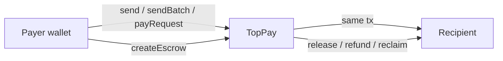

# TopPay v2 design

> **As built (supersedes any conflicting text below).** The security review changed five things:
> 1. Every external function carries `nonReentrant`, including `send` and `sendBatch`. A recipient that calls back into TopPay fails safely with `ReentrantCall` and the sender keeps the funds.
> 2. New `sendBatchBestEffort(tos, amounts, memos, gasPerRecipient)` skips recipients that cannot receive (emits `PaymentSkipped`) and refunds their amount to the sender in the same transaction. Each recipient gets at most `gasPerRecipient` gas (30,000 to 500,000) and the call reverts with `InsufficientGas` if the transaction does not carry enough gas, so a gas-burning recipient cannot fail the batch. `sendBatch` stays all-or-nothing.
> 3. Escrow has a payer-controlled `refundTo` (default: the payer). `setEscrowRefundAddress` lets the payer redirect refunds while the escrow is open. `refundEscrow` and `reclaimEscrow` pay `refundTo`.
> 4. Errors carry context (IDs, callers, supplied and expected values).
> 5. `EscrowRefunded` and `EscrowReclaimed` events include the `refundTo` destination.

## 1. Metadata

- Status: Draft, awaiting owner confirmation
- Target chain: Arc Mainnet (chain ID 5042). Native gas token is USDC (18 decimals natively, 6 in the ERC-20 view)
- Language and toolchain: Solidity 0.8.28 (checked arithmetic, custom errors), Foundry, EVM target `cancun`, deployed by the owner through Remix
- Identifier: `keccak256("ArcSend.v2")` (a tag frozen at the contract's original name; the contract is now called TopPay). v1 was never deployed, so v2 replaces it with no migration
- Reviews: [ ] Design (owner), [ ] Security (automated review at maximum depth, plus an independent paid audit before large value)

## 2. Action items

- Confirm the escrow rules in section 10 (they were not fully specified).
- Confirm that the app should route payments through the contract (section 9).

## 3. Goals and non-goals

Goals
- One contract address for all TopPay payments: single payments with a memo, batch payments, payment requests paid by ID, and escrow.
- Recipients always receive 100% (no fee).
- No owner, no admin, no pause, no upgrade. Behavior is fixed forever.
- Payments, batches and request payments forward funds in the same transaction. Only open escrows hold funds.
- Every action emits an event so the app can build history from logs alone.

Non-goals
- Other tokens (EURC and other ERC-20s). Native USDC only.
- Fees, treasury, referral logic.
- Dispute resolution or arbitration by any third party.
- Recovering funds sent to the contract by other means (forced sends).
- Deployment by this tool. The owner deploys through Remix.

## 4. Requirements

Functional
1. `send` forwards `msg.value` to a recipient and emits a receipt with a memo.
2. `sendBatch` pays up to 100 recipients in one transaction. `msg.value` must equal the sum of amounts exactly.
3. A payee can create a payment request (amount, optional restricted payer, optional expiry, memo). A payer pays it exactly once, by ID. The payee can cancel it while open.
4. A payer can open an escrow for a payee with a deadline. The payer releases it to the payee. The payee can refund it to the payer. After the deadline the payer can reclaim it alone.

Security (each is a testable assertion)
- S1. No function takes a fee: the recipient balance increases by exactly the amount sent.
- S2. No privileged function exists. No address can move funds that is not the payer, payee or recipient named by the original call.
- S3. `address(this).balance >= sum(amount of open escrows)` always, and equals it unless funds were force-sent.
- S4. A request can be paid at most once. An escrow can leave `Open` at most once.
- S5. Any failed forward reverts the whole transaction, including every earlier forward in a batch.
- S6. A reentrant recipient cannot double-spend a request or an escrow.

## 5. Terminology and actors

| Term | Meaning |
| --- | --- |
| Amount | Native USDC in 18-decimal wei. 1 USDC = 1e18. The ERC-20 view shows 6 decimals, so amounts that are not multiples of 1e12 include dust that balanceOf cannot show |
| Memo | A caller-defined `bytes32` reference (for example an invoice hash) |
| Request | A payee-created invoice, paid once by ID |
| Escrow | Funds held for one payee until released, refunded or reclaimed |

| Actor | On/off-chain | Trust | Can do |
| --- | --- | --- | --- |
| Payer / sender | Onchain | Untrusted | Send, batch, pay a request, open/release/reclaim own escrow |
| Payee / recipient | Onchain | Untrusted (may be a contract) | Create/cancel own request, refund own escrow |
| Anyone | Onchain | Untrusted | Read state and events |
| Contract owner | None | n/a | Does not exist |

## 6. Language and runtime

- Solidity 0.8.28 exactly (pragma pinned). Checked arithmetic. No `unchecked` blocks except the loop counter increment, which is bounded by the 100-recipient cap.
- EVM: `cancun`. Arc targets Osaka, which is a superset. The code uses no opcode that behaves differently on Arc.
- No libraries and no imports. A tiny reentrancy guard is written inline so the file works as a single Remix file.

## 7. Transaction and execution model

All external functions are atomic. State is committed only if every forward succeeds.

- State-bearing functions (`payRequest`, `cancelRequest`, `createEscrow`, `releaseEscrow`, `refundEscrow`, `reclaimEscrow`) follow checks, effects, then the external call, and also carry a `nonReentrant` guard.
- `send` and `sendBatch` touch no storage, so re-entering them is harmless and they are not guarded. This also keeps smart-contract wallets working as recipients.
- Arc rules honored: a value transfer to the zero address reverts, a blocklisted sender or recipient reverts, and the system emits its own USDC Transfer log (so history needs no extra events, though the contract emits its own receipts).

## 8. Chain standards and interfaces

No token standard is implemented. The contract only moves the native coin via `call{value:}`. EVM role mapping: N/A (no roles).

## 9. Architecture and flow of funds

| Flow | Who moves what | Invariant |
| --- | --- | --- |
| send | Payer value goes to recipient in the same call | Contract balance unchanged |
| sendBatch | Payer value split to N recipients | `sum(amounts) == msg.value`, balance unchanged |
| payRequest | Payer value goes to payee | Request moves Open to Paid before the transfer |
| createEscrow | Payer value stays in the contract | balance increases by exactly `amount` |
| release / refund / reclaim | Escrow amount goes to payee / payer / payer | Escrow leaves Open before the transfer |

Resting-state invariant: `balance == sum(open escrow amounts)` (plus any forced dust).

App assumption: TopPay today sends plain native transfers. Routing payments through the contract is a separate frontend change that needs your confirmation. The contract works on its own either way.

## 10. Contract design

Roles: none.

Storage
- `uint256 _lock` (reentrancy guard)
- `uint256 nextRequestId` (starts at 1), `mapping(uint256 => Request) requests`
- `uint256 nextEscrowId` (starts at 1), `mapping(uint256 => Escrow) escrows`
- `Request { address payee; uint8 status; uint64 expiry; address payer; uint96 amount; bytes32 memo }`, status `None, Open, Paid, Cancelled`. `payer == 0` means anyone may pay. `expiry == 0` means no expiry.
- `Escrow { address payer; uint8 status; uint64 deadline; address payee; uint96 amount; bytes32 memo }`, status `None, Open, Released, Refunded, Reclaimed`.
- `uint96` holds up to about 79 billion USDC, which is far above any realistic payment.

Write functions

| Function | Caller | State mutated | Events | Reverts |
| --- | --- | --- | --- | --- |
| `send(to, memo)` payable | anyone | none | `Payment` | zero address, self, zero value, failed transfer |
| `sendBatch(tos[], amounts[], memos[])` payable | anyone | none | `Payment` per entry, `BatchSent` | length mismatch, empty, more than 100, any zero address/self/zero amount, `sum != msg.value`, any failed transfer |
| `createRequest(payer, amount, expiry, memo)` | payee (caller) | new request | `RequestCreated` | zero amount, amount over uint96, expiry in the past, `payer == msg.sender` |
| `payRequest(id)` payable | named payer or anyone | request to Paid | `RequestPaid`, `Payment` | not open, expired, wrong payer, `msg.value != amount`, failed transfer |
| `cancelRequest(id)` | payee | request to Cancelled | `RequestCancelled` | not open, not payee |
| `createEscrow(payee, deadline, memo)` payable | payer (caller) | new escrow, funds held | `EscrowCreated` | zero value, value over uint96, zero/self/contract-self payee, deadline outside [now + 1 hour, now + 365 days] |
| `releaseEscrow(id)` | payer | escrow to Released | `EscrowReleased`, `Payment` | not open, not payer, failed transfer |
| `refundEscrow(id)` | payee | escrow to Refunded | `EscrowRefunded` | not open, not payee, failed transfer |
| `reclaimEscrow(id)` | payer | escrow to Reclaimed | `EscrowReclaimed` | not open, not payer, deadline not passed, failed transfer |

Read functions: `getRequest(id)`, `getEscrow(id)`, `identifier()`, `IDENTIFIER`, `MAX_BATCH`, `MIN_ESCROW_DURATION`, `MAX_ESCROW_DURATION`. No `receive` or `fallback`, so plain sends revert.

Escrow rules (assumptions, please confirm)
- The payer can release at any time while open, even after the deadline, until reclaimed.
- The payee can refund the payer at any time while open (a voluntary cancel by the person being paid).
- Only after the deadline can the payer reclaim without the payee. There is no third-party arbiter, so a payer who never releases can reclaim at the deadline. The payee is protected only by trust in the payer plus the choice of deadline.

Events (all indexed fields are the ones alerting needs)
- `Payment(from indexed, to indexed, amount, memo indexed)` (same signature as v1)
- `BatchSent(from indexed, total, count)`
- `RequestCreated(id indexed, payee indexed, payer indexed, amount, expiry, memo)`, `RequestPaid(id indexed, payer indexed, payee indexed, amount)`, `RequestCancelled(id indexed, payee indexed)`
- `EscrowCreated(id indexed, payer indexed, payee indexed, amount, deadline, memo)`, `EscrowReleased(id indexed, payee indexed, amount)`, `EscrowRefunded(id indexed, payer indexed, amount)`, `EscrowReclaimed(id indexed, payer indexed, amount)`

## 11. Deployment and initialization

No constructor and no initialization. The deployer has no special power after deployment. The owner deploys from Remix with solc 0.8.28, optimizer 200 runs, EVM `cancun`, on chain 5042, then checks `identifier()`.

## 12. Upgradeability

None, by choice. Migration story: a contract switch. A new version would have a new address and a new identifier, and the app would be re-pointed through `VITE_TOPPAY_CONTRACT_ADDRESS`. Open escrows on the old contract stay claimable there because the old contract cannot be changed or switched off.

## 13. Key management

No keys have contract-level power. Replay protection is not needed (no signatures).

## 14. Security considerations

| Vulnerability | Applicable? | Mitigation |
| --- | --- | --- |
| Reentrancy | Yes, every forward | State changes before the call, `nonReentrant` on state-bearing functions, `send`/`sendBatch` are stateless |
| Access control | Yes | Each action checks the stored payer/payee. No global roles |
| Overflow | Checked | Batch sum uses checked addition. Casts to `uint96`/`uint64` are range-checked first |
| Unchecked external call | Yes | Every `call` return is checked |
| Fee-on-transfer tokens | N/A | Native coin only |
| Signature replay | N/A | No signatures |
| Front-running | Partly | Requests are exact-amount and single-use, so a front-runner can only pay the request on the payer's behalf. Restricted requests block others |
| Oracles and flash loans | N/A | None used |
| Denial of service | Yes | Batch capped at 100, push payments only to the caller's chosen recipients, a failing recipient only fails that caller's own transaction |
| Delegatecall / proxy | N/A | None |
| Timestamp dependence | Yes | Only for expiry and escrow deadlines, with one-hour minimum. Arc timestamps are non-decreasing at one-second granularity, which is acceptable |
| Approval persistence | N/A | No approvals |
| Centralization | None | No privileged address |
| Blocklist (Arc) | Yes | A blocklisted recipient reverts the forward. Escrow stays open so the payer can reclaim after the deadline. A blocklisted payer cannot receive a reclaim (see residual risks) |
| Forced funds | Yes | Selfdestruct or block rewards can add balance that nobody can withdraw. Harmless, since accounting uses per-escrow amounts |
| Griefing by contract recipient | Yes | A recipient contract can revert, which only blocks its own payment |

## 15. Trust model and threat analysis

There are no privileged actors, so there is no compromised-admin scenario. The worst case for a user is their own key compromise. Escrow adds counterparty trust: the payer decides release, and the payee relies on the payer. Detection: monitor events below.

## 16. Emergency response

None available by design (no pause, no rescue). Because the contract cannot be stopped, correctness is the only control, which is why testing is heavy. If a bug is found after deployment the response is to stop pointing the app at it, deploy a new version, and tell users with open escrows to release, refund or reclaim.

## 17. Failure scenarios

- Recipient reverts in `send`: the whole call reverts, no receipt, no funds move.
- One bad recipient in a batch: the entire batch reverts, nothing is partially paid.
- Recipient contract re-enters `payRequest`: the status is already Paid, the inner call reverts, the outer reverts as a whole.
- Escrow payee is blocklisted: `releaseEscrow` reverts, the escrow stays Open, the payer reclaims after the deadline.
- Escrow payer is a contract that cannot receive: reclaim reverts and the funds cannot be recovered. The payer should use a normal wallet or a contract that accepts native USDC.
- Payee never gets paid because the payer vanishes: the payee gets nothing at the deadline. This is the trust assumption of a no-arbiter escrow.

## 18. Priorities and tradeoffs

| Decision | Tradeoff | Alternatives rejected |
| --- | --- | --- |
| No admin, no pause | Cannot stop a bug, but there is no key to steal | Owner with pause (rejected by you), timelocked owner |
| Escrow holds funds | Breaks pure pass-through, but only for open escrows with strict accounting | Dropping escrow, or a payee-pull pattern for every payment |
| Payer-only reclaim after a deadline | Payer has leverage, but no funds are stuck forever | Payee-claims-after-deadline, third-party arbiter |
| Native USDC only | No EURC or ERC-20 support | A token router (more surface, approvals) |
| `send` unguarded | Allows reentrant recipients, which is harmless because it is stateless | Guard everything (breaks some smart wallets) |

## 19. Testing strategy

- Foundry unit tests for every function and every revert, events field by field.
- Fuzz: amounts, recipients, batch sizes, deadlines.
- Invariants: `balance == sum(open escrows)`, a request is paid at most once, an escrow leaves Open at most once, sent value equals received value.
- Reentrant and reverting recipient contracts for send, batch, request and every escrow exit.
- Static analysis with Slither, plus a maximum-depth review. Commands: `forge build`, `forge test`.
- Branch coverage target: every function and revert branch covered.
- An independent paid audit is recommended before significant value flows through an immutable contract.

## 20. Third-party libraries

None. The reentrancy guard and checks are inline so the file is self-contained for Remix.

## 21. Monitoring

| Event | Alert | Severity |
| --- | --- | --- |
| `EscrowCreated` with unusually large amount | Above your threshold | Info |
| Contract balance greater than sum of open escrows | Any | Low (forced funds) |
| Contract balance lower than sum of open escrows | Any | Critical (accounting bug) |
| Spike in `TransferFailed`-style reverts | Sustained | Low |

## 22. Worked example

You create a request for 25 USDC with memo `inv-001`. `createRequest(0x0, 25e18, 0, memo)` returns ID 1 and emits `RequestCreated`. The payer calls `payRequest(1)` with 25e18. The contract sets status Paid, emits `RequestPaid` and `Payment`, and forwards 25e18 to you in the same transaction. Calling `payRequest(1)` again reverts as not open.
